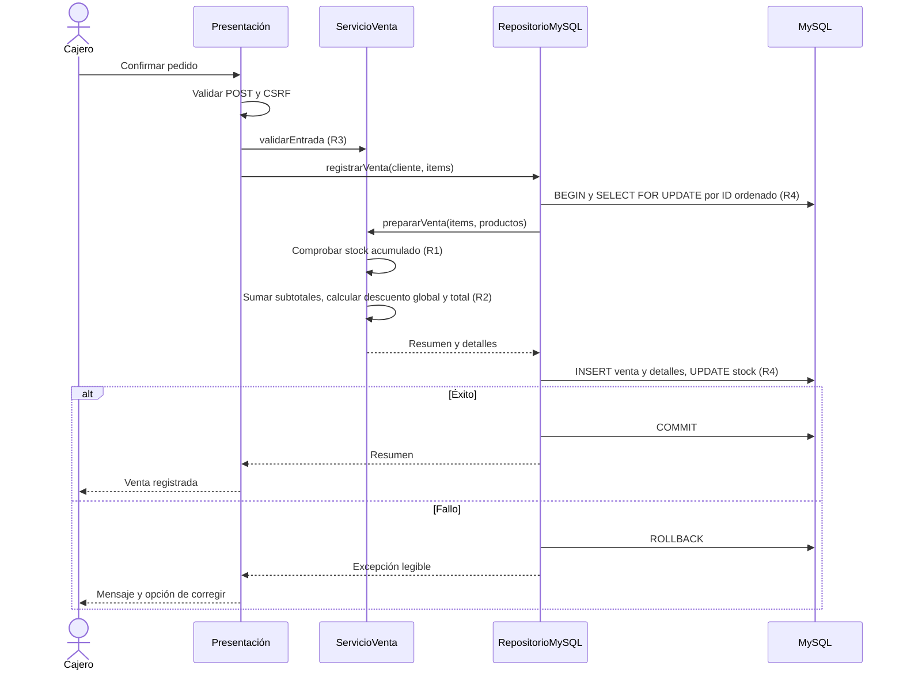

# Diseño de Bodega Doña Rosa

## Arquitectura en tres capas

1. Presentación: index.php, venta.php, guardar_venta.php, producto_nuevo.php, producto_editar.php y templates/producto_formulario.php. Gestiona HTML, HTTP, sesión y CSRF; no contiene SQL. JavaScript ofrece vista previa; el servidor es la autoridad para precios, stock y descuento.
2. Negocio: src/ServicioVenta.php, clase final con métodos estáticos puros. No contiene HTML, echo, SQL, PDO, sesiones ni superglobales. Se prueba sin Apache ni base de datos.
3. Datos: src/RepositorioMySQL.php. Recibe PDO por constructor; usa sentencias preparadas, bloqueos FOR UPDATE, commit y rollback. Delega la preparación del pedido al servicio con los productos bloqueados.

Se mantiene la estructura y métodos estáticos solicitados por el usuario y P5 de la guía. El diseño anterior con dos repositorios e interfaces queda sustituido por este diseño de repositorio único.

## Modelo de datos efectivo

Se conserva el esquema existente para no perder datos. Difiere del ejemplo resumido de la guía en nombres y capacidades de campos; sql/bodega.sql es el DDL vigente. No se ejecuta una migración destructiva para renombrar precio_unitario a precio ni reducir nombres de 100 a 80 caracteres.

| Tabla | Campos y tipos |
|---|---|
| producto | id INT UNSIGNED PK AUTO_INCREMENT; nombre VARCHAR(100) NOT NULL UNIQUE; precio_unitario DECIMAL(10,2) NOT NULL; stock INT UNSIGNED NOT NULL DEFAULT 0 |
| venta | id INT UNSIGNED PK AUTO_INCREMENT; cliente VARCHAR(100) NOT NULL DEFAULT ''; fecha DATETIME NOT NULL DEFAULT CURRENT_TIMESTAMP; total DECIMAL(10,2) NOT NULL |
| detalle_venta | id INT UNSIGNED PK AUTO_INCREMENT; venta_id INT UNSIGNED NOT NULL FK venta.id; producto_id INT UNSIGNED NOT NULL FK producto.id; cantidad INT UNSIGNED NOT NULL; precio_unitario DECIMAL(10,2) NOT NULL; subtotal DECIMAL(10,2) NOT NULL; descuento DECIMAL(10,2) NOT NULL DEFAULT 0.00 |

Motor InnoDB, utf8mb4, colación utf8mb4_unicode_ci. Sin procedimientos almacenados ni triggers. Las claves foráneas impiden borrar productos con ventas. El precio del detalle preserva el histórico. Subtotal de venta = suma de detalle.subtotal; descuento de venta = suma de detalle.descuento. No se recalculan ventas históricas anteriores al cambio de R2.

## Reglas y métodos

| Método de ServicioVenta | Función |
|---|---|
| validarCantidad(int): bool | R3, rango 1 a 9999 |
| hayStock(int, int): bool | R1, permite igualdad |
| calcularSubtotal(array): float | Suma precio por cantidad en céntimos |
| calcularDescuento(float): float | R2, 5 % global solo sobre 100 |
| calcularTotal(float): float | Subtotal global menos descuento |
| validarEntrada(mixed, mixed, bool): array | Normaliza cliente y líneas, rechaza decimales antes del cast |
| prepararVenta(array, array): array | R1 acumulado, subtotal y R2 global, reparto exacto entre detalles |
| validarProducto(array): array | Errores por campo para alta y edición |

prepararVenta devuelve items, subtotal, descuento y total. El reparto calcula el descuento acumulado proporcional y asigna a cada línea la diferencia con el acumulado anterior, evitando diferencias de céntimos. R4 permanece en el repositorio porque requiere persistencia.

## Secuencia de registrar venta

## Pruebas y despliegue

phpunit.xml ejecuta solo archivos *Test.php: pruebas unitarias puras. Los scripts de integración y HTTP se ejecutan aparte. tests/mutantes.php ensaya tres defectos de una línea en copias temporales, con base verde y sintaxis válida; no altera la aplicación ni representa una revisión rival. config/env.php lee variables DB_HOST, DB_USER, DB_PASSWORD y DB_NAME y queda ignorado en Git. config/env.ejemplo.php permite reconstruirlo. SQL de producción no crea ni selecciona bases.
